<div align="center">

# GeoHand

**An interactive 3D model for exploring Earth's interior using hand gestures, seismic evidence and guided lessons.**

Developed by **[Ibaad Sidik](https://github.com/IbaadGEO)**. Hand tracking is based on **[HoloHand](https://github.com/tubakhxn/HoloHand-Gesture-Agent-3D)** by Tuba Khan.

[](https://geohand-theta.vercel.app) [](#camera-privacy-and-security)  [](#references)    [](LICENSE)

<a href="https://geohand-theta.vercel.app">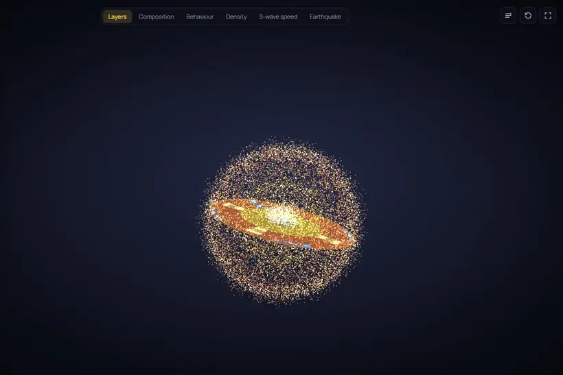</a>

<sub>Demonstration of the 3D model, layer selection and Earthquake view. Recorded using mouse controls in Chromium. The same interactions can be carried out using a webcam and hand gestures. <a href="https://geohand-theta.vercel.app">Try GeoHand here</a> on desktop Chrome, Edge or Firefox.</sub>

</div>

## About the project

GeoHand is a personal project combining my interests in geoscience, programming and interactive learning. I developed it to explore how a 3D application could make the structure of the Earth easier to understand, particularly the relationship between what we model and the scientific evidence behind it.

We cannot directly observe most of the Earth's interior. Much of what we know comes from seismic waves and other indirect measurements, which can be difficult to interpret from a static diagram. GeoHand allows users to rotate and separate the Earth's layers, select individual regions and examine their composition, physical behaviour and supporting evidence. Scientific explanations include citations to the relevant papers, pages or tables.

The project began as an Earth's Interior model in my [HoloHand fork](https://github.com/IbaadGEO/HoloHand-Gesture-Agent-3D), based on Tuba Khan's original gesture-control project. I developed it further into a standalone educational application with different learning levels, guided activities, a seismic-wave mission and supporting references.

This is an independent learning project, not a commissioned scientific study. Future models will be informed by feedback and testing with learners.

**Live application:** https://geohand-theta.vercel.app

## Explore and learn

### Choose a level

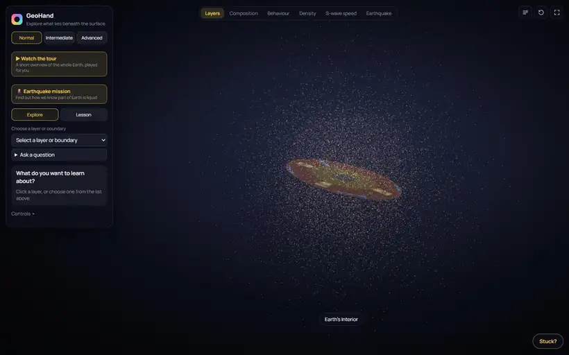

<sub>Normal, then Intermediate, then Advanced. Each level adds layers, boundaries and views; the part picked each time (outer core, mantle transition zone, post-perovskite) appears from that level on.</sub>

The content is organised into three levels. Each adds detail to the model and explanations, rather than requiring users to start with the most technical material.

| Level | Focus | Parts | Questions |
|---|---|---:|---:|
| **Normal** | The main layers and boundaries, explained in accessible language | 8 | 53 |
| **Intermediate** | Additional structures, measurements and supporting evidence | 16 | 98 |
| **Advanced** | More detailed seismic models, interpretations and unresolved questions | 21 | 125 |

<table>
<tr>
<td width="330">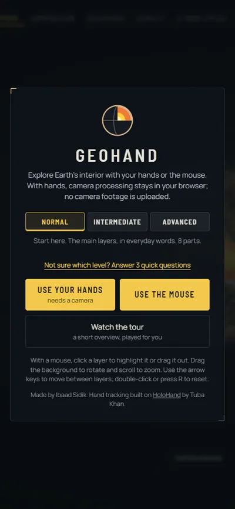</td>
<td>

**Not sure which level?**

Users can choose a level directly or answer three short questions about the outer core, the depth of the core and inner-core rotation. The app suggests Normal for 0–1 correct answers, Intermediate for 2 and Advanced for 3. Each answer includes an explanation and source. The selected level can be changed at any time; the answers are not stored or sent.

</td>
</tr>
</table>

### Explore the Earth's structure

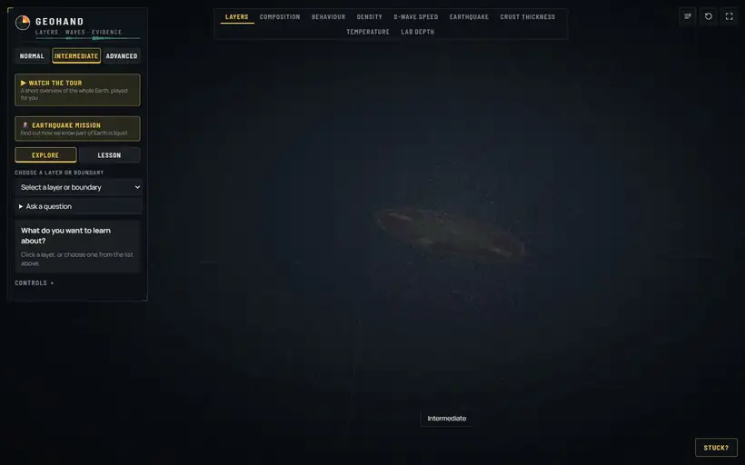

The model can be pulled apart to show individual layers and boundaries. Selecting a part opens a description of its depth, composition, physical properties and the evidence used to study it. From there, users can start a short lesson, continue the guided walkthrough or switch to a relevant visualisation.

Technical terms such as PREM, pyrolite and S waves are explained in simpler language at Normal level, while the higher levels retain more of the underlying scientific detail.

### Compare different representations

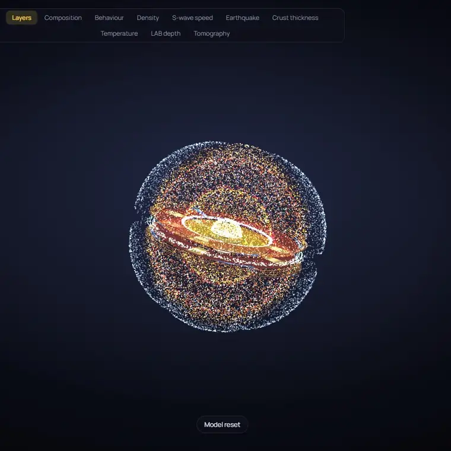

The same cross-section can be viewed by **composition**, **physical behaviour**, **density** and **S-wave speed**. These views use published Earth models to illustrate why geological and seismic boundaries do not always describe the same thing.

The **Earthquake** view calculates P- and S-wave paths from PREM wave speeds and illustrates the resulting shadow zones. The paths are computed in the browser rather than manually drawn. Intermediate and Advanced levels also include crustal thickness from **CRUST1.0**, mantle temperature from **Katsura (2022)** and lithosphere depth derived from seafloor age using **Seton et al. (2020)** and **Fischer et al. (2010)**. Advanced adds a tomography section from **SEMUCB-WM1** (French and Romanowicz, 2014; EarthScope EMC, doi:10.17611/dp/emc.2023.semucbwm1.1), displayed with the authors' permission.

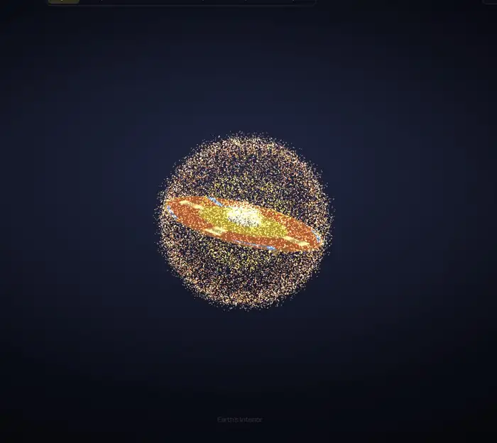

<sub>The Earthquake view at double speed. Every path is calculated in the browser from PREM wave speeds.</sub>

### Guided lessons and activities


<table>
<tr>
<td width="50%">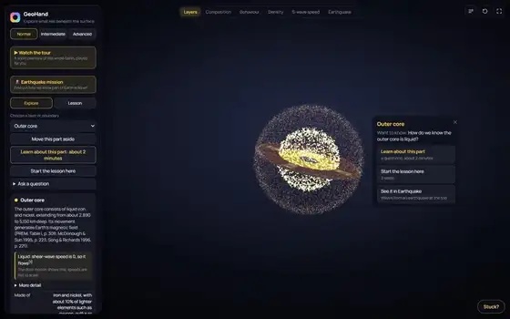<br><b>Learn a layer.</b> A check question, where it sits, how it works, a task on the model, the evidence and a short test.</td>
<td width="50%">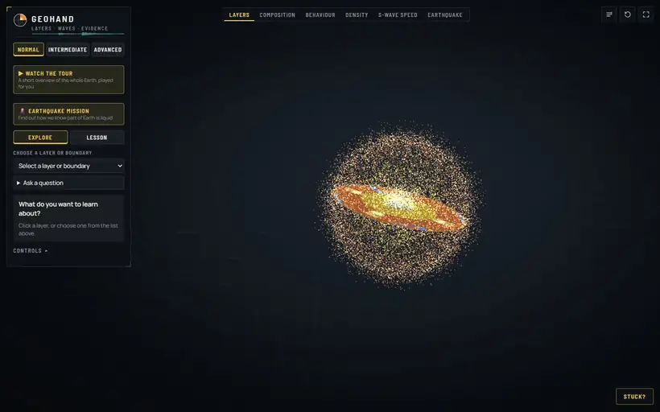<br><b>Guided lesson.</b> One stop at a time from the surface to the centre, with the model moving to each layer.</td>
</tr>
</table>

- **Learn a layer:** A short activity begins with a question, introduces the selected structure, shows the relevant evidence and ends with a short quiz.
- **Guided lesson:** Work from the surface towards the centre, with activities including a comparison of oceanic and continental crust.
- **Earthquake mission:** Identify where S waves stop, locate the core–mantle boundary and use the wave paths to explain the observations.
- **Automatic tour:** Follow the Earth's layers without needing hand tracking or mouse input.
- **Help and feedback:** Replay a step, return to an earlier activity, ask a question or report a problem.

## Using GeoHand

1. Open **[geohand-theta.vercel.app](https://geohand-theta.vercel.app)** on a desktop or laptop.
2. Select a learning level or use the three-question level finder.
3. Choose **Use your hands** and allow camera access, or choose **Use the mouse**.
4. Follow the introductory controls, or skip them and begin exploring.

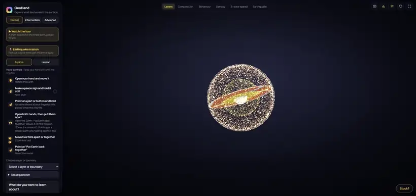

<sub>Recorded with a webcam in Chrome, with the camera background turned off (camera button, top right) so only the tracked hand points show. Camera frames stay on the device and are not uploaded or stored.</sub>

| Action | Mouse / keyboard | Hand tracking |
|---|---|---|
| Rotate the Earth | Drag the background | Open hand and move |
| Separate the layers | **Pull it apart**, or space bar | Pull two open hands apart, or point at the Earth and hold |
| Restore the Earth | Double-click, or press R | Point at **Put Earth back together** |
| Select a layer or button | Click | Point and hold until the ring fills |
| Zoom | Scroll | Move two fists apart or together |
| Go to the next layer | Arrow keys | Hold a peace sign still |

The camera is optional. All main learning activities can also be completed using the mouse and keyboard.

## Scientific basis and limitations

GeoHand draws on published geophysical models and research rather than treating the 3D representation as a direct observation of the Earth's interior.

- **PREM** (Dziewonski and Anderson, 1981) provides reference density and seismic-wave properties used across the model, including the calculated earthquake ray paths.
- **ak135** (Kennett, Engdahl and Buland, 1995) provides reference depths for several boundaries used in the visualisation.
- **CRUST1.0**, published heat-flow and temperature models, seafloor-age data and **SEMUCB-WM1** provide additional views at the higher learning levels.
- **Individual scientific studies** support descriptions of mantle convection, subducting slabs, plumes, core composition and inner-core structure.

The model uses simplified geometry. Some near-surface layers are enlarged to make them visible, and selected boundary depths follow reference Earth models rather than local measurements. Slab and plume positions in schematic views are illustrative. The explanations distinguish these choices from published observations and interpretations, with sources given in the app.

## How the application works

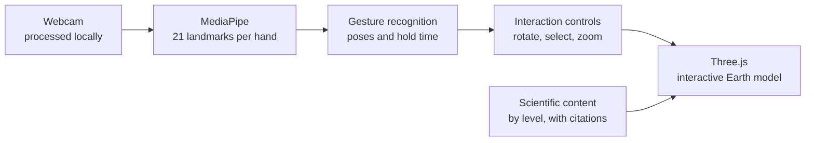

MediaPipe Hand Landmarker detects up to two hands, with 21 landmarks per hand. The gesture system identifies open hands, fists, pointing, peace signs and two-hand movements. A short hold is required before certain actions are triggered, reducing accidental selections during ordinary movement.

Three.js renders the Earth as interactive point-cloud layers. Scientific text, values and references are maintained separately in content files, allowing the material to be checked against its sources. The application is built with Vite and runs in the browser.

## Development and testing

I tested both the scientific content and the way the application responds to gestures. The work included automated tests, repeated webcam sessions, independent content reviews and checks on the deployed site.

| Test area | What was checked |
|---|---|
| **202 automated checks** | 183 unit tests across 22 files covering content, models, seismic paths, learning flow, pointing, search and the question/report endpoint, plus 19 gesture self-tests using recorded hand data |
| **Scientific references** | Content checks reject missing or unknown references, draft text and, for release, sources not yet checked against the original paper. Values and page references are recorded in [`docs/values-to-check.md`](docs/values-to-check.md) |
| **13 webcam test runs** | Gesture accuracy, hand identification, fingertip pointing and unintended actions were examined from recorded runs |
| **External reviews** | Independent review of figures and wording against 16 source PDFs, alongside first-time-user reviews with mouse and camera controls |
| **Deployed application** | The question/report endpoint's validation, bot and rate-limit responses were tested, along with submission, storage and deletion of real test entries |

### Issues identified during testing

Several problems only became apparent during live use. The changes below were made in response to those findings.

| Issue | Change made |
|---|---|
| Swipe, point and pinch gestures were activated unintentionally | Replaced swipes with deliberate, held poses and a visible progress ring |
| Left and right hand identities changed between frames | Tracked hands by position instead of relying on MediaPipe's changing labels |
| Lowering both hands closed the Earth | Restricted the two-hand gesture to opening; closing uses a separate control |
| Hands already far apart could open the Earth unintentionally | Measured movement from the hands' closest separation |
| The Earth could reopen after being reset | Reset the stored starting separation whenever the model was closed |
| A point used to open the model immediately selected a layer | Required the fingertip to leave the activation position before another selection |
| The reset control was difficult to reach using the camera | Moved it to the top-right area |
| Clicking interface controls also selected a model layer behind them | Prevented those clicks from reaching the 3D model |
| The live question form was rejected under the site's referrer policy | Corrected the origin handling used by the form |
| A font was blocked by the deployed Content-Security-Policy | Updated the policy to allow the locally embedded font |
| An explanation described the outer core as PREM's only liquid layer | Corrected it after review because PREM also includes an ocean layer |

## Camera privacy and security

Hand tracking runs in the browser. **Camera frames are processed on the device and are not uploaded, recorded or saved by GeoHand.** Mouse controls are available for anyone who does not want to enable a camera.

| Area | Implementation |
|---|---|
| **Camera processing** | Frames are passed to MediaPipe in the browser. The application's Content-Security-Policy uses `connect-src 'self'` to prevent connections to external servers |
| **Third-party requests** | The app, MediaPipe files, model and font are served from the same site. `default-src 'self'` prevents loading resources from other origins |
| **Device permissions** | Permissions-Policy blocks microphone, location, screen capture and other device access |
| **Questions and reports** | Questions contain the submitted text, learning level and selected part. Reports may also include control mode, view, browser version and screen size. Neither includes camera footage or screenshots |
| **IP handling** | IP addresses are not stored. A daily-changing hash is used for limits of 5 messages per hour and 20 per day |
| **Submission checks** | The endpoint checks the requesting site and individual fields, limits message size and rejects bot-trap submissions |

You can inspect requests using your browser's developer tools (**F12**, then **Network**) while using the application.

### Questions and bug reports

<table>
<tr>
<td width="330">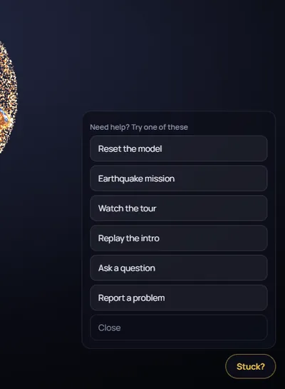</td>
<td>

The **Ask a question** option in the information panel and **Report a problem** in the help menu send submissions to a private inbox. Questions that receive a referenced answer can be added to the application and recorded under [Live updates](#live-updates).

</td>
</tr>
</table>

## Run locally

You will need Node.js and npm. From the repository directory, run:

```bash
npm install
npm run dev
```

To run the automated tests:

```bash
npm test
```

Adding `?debug` to the local app address opens the guided gesture testing interface in developer builds. `npm run updates` regenerates the references and live-updates sections in this README from the application's content.

## Credits

GeoHand's original hand-tracking and gesture-control work came from [HoloHand](https://github.com/IbaadGEO/HoloHand-Gesture-Agent-3D), my fork of Tuba Khan's [HoloHand-Gesture-Agent-3D](https://github.com/tubakhxn/HoloHand-Gesture-Agent-3D). The relevant code remains under its MIT licence, included in [`LICENSE-HoloHand`](LICENSE-HoloHand).

The application uses [MediaPipe](https://ai.google.dev/edge/mediapipe/solutions/vision/hand_landmarker) for hand tracking, [three.js](https://threejs.org) for rendering and the [Manrope](https://github.com/sharanda/manrope) font under the SIL Open Font License 1.1. Visual references that informed parts of the application are acknowledged in [`docs/inspiration.md`](docs/inspiration.md).

## Licence

Copyright © 2026 Ibaad Sidik. **All rights reserved.** GeoHand's original code, content, questions, design and media may not be copied, reused or adapted without written permission. See [`LICENSE`](LICENSE). The live site is available for personal learning.

## References

The list below is generated from the application's source list using `npm run updates`. Scientific claims within the application include the relevant page or table references.

<!-- references:start -->
- Anzellini, S., Dewaele, A., Mezouar, M., Loubeyre, P. and Morard, G. (2013) 'Melting of iron at Earth's inner core boundary based on fast X-ray diffraction', *Science*, 340(6131), pp. 464–466. Available at: https://doi.org/10.1126/science.1233514
- Christensen, N.I. and Mooney, W.D. (1995) 'Seismic velocity structure and composition of the continental crust: A global view', *Journal of Geophysical Research: Solid Earth*, 100(B6), pp. 9761–9788. Available at: https://doi.org/10.1029/95jb00259
- Davies, J.H. and Davies, D.R. (2010) 'Earth's surface heat flux', *Solid Earth*, 1(1), pp. 5–24. Available at: https://doi.org/10.5194/se-1-5-2010
- Deuss, A. (2014) 'Heterogeneity and anisotropy of Earth's inner core', *Annual Review of Earth and Planetary Sciences*, 42, pp. 103–126. Available at: https://doi.org/10.1146/annurev-earth-060313-054658
- Dziewonski, A.M. and Anderson, D.L. (1981) 'Preliminary reference Earth model', *Physics of the Earth and Planetary Interiors*, 25(4), pp. 297–356. Available at: https://doi.org/10.1016/0031-9201(81)90046-7
- Fischer, K.M., Ford, H.A., Abt, D.L. and Rychert, C.A. (2010) 'The lithosphere–asthenosphere boundary', *Annual Review of Earth and Planetary Sciences*, 38, pp. 551–575. Available at: https://doi.org/10.1146/annurev-earth-040809-152438
- French, S.W. and Romanowicz, B. (2015) 'Broad plumes rooted at the base of the Earth's mantle beneath major hotspots', *Nature*, 525(7567), pp. 95–99. Available at: https://doi.org/10.1038/nature14876
- French, S.W. and Romanowicz, B.A. (2014) 'Whole-mantle radially anisotropic shear velocity structure from spectral-element waveform tomography', *Geophysical Journal International*, 199(3), pp. 1303–1327. Available at: https://doi.org/10.1093/gji/ggu334
- Frost, D.J. (2008) 'The upper mantle and transition zone', *Elements*, 4(3), pp. 171–176. Available at: https://doi.org/10.2113/gselements.4.3.171
- Fukao, Y. and Obayashi, M. (2013) 'Subducted slabs stagnant above, penetrating through, and trapped below the 660 km discontinuity', *Journal of Geophysical Research: Solid Earth*, 118(11), pp. 5920–5938. Available at: https://doi.org/10.1002/2013jb010466
- Garnero, E.J., McNamara, A.K. and Shim, S.-H. (2016) 'Continent-sized anomalous zones with low seismic velocity at the base of Earth's mantle', *Nature Geoscience*, 9(7), pp. 481–489. Available at: https://doi.org/10.1038/ngeo2733
- Hirose, K., Labrosse, S. and Hernlund, J. (2013) 'Composition and state of the core', *Annual Review of Earth and Planetary Sciences*, 41, pp. 657–691. Available at: https://doi.org/10.1146/annurev-earth-050212-124007
- Ishii, M. and Dziewoński, A.M. (2002) 'The innermost inner core of the earth: Evidence for a change in anisotropic behavior at the radius of about 300 km', *Proceedings of the National Academy of Sciences*, 99(22), pp. 14026–14030. Available at: https://doi.org/10.1073/pnas.172508499
- Katsura, T. (2022) 'A revised adiabatic temperature profile for the mantle', *Journal of Geophysical Research: Solid Earth*, 127(2), e2021JB023562. Available at: https://doi.org/10.1029/2021JB023562
- Kennett, B.L.N., Engdahl, E.R. and Buland, R. (1995) 'Constraints on seismic velocities in the Earth from traveltimes', *Geophysical Journal International*, 122(1), pp. 108–124. Available at: https://doi.org/10.1111/j.1365-246x.1995.tb03540.x
- Laske, G., Masters, G., Ma, Z. and Pasyanos, M. (2013) 'Update on CRUST1.0: A 1-degree global model of Earth’s crust', *Geophysical Research Abstracts*, 15, EGU2013-2658. Available at: https://igppweb.ucsd.edu/~gabi/crust1.html
- Lay, T., Williams, Q. and Garnero, E.J. (1998) 'The core–mantle boundary layer and deep Earth dynamics', *Nature*, 392(6675), pp. 461–468. Available at: https://doi.org/10.1038/33083
- McDonough, W.F. and Sun, S.-s. (1995) 'The composition of the Earth', *Chemical Geology*, 120(3–4), pp. 223–253. Available at: https://doi.org/10.1016/0009-2541(94)00140-4
- Mooney, W.D., Laske, G. and Masters, T.G. (1998) 'CRUST 5.1: A global crustal model at 5° × 5°', *Journal of Geophysical Research: Solid Earth*, 103(B1), pp. 727–747. Available at: https://doi.org/10.1029/97jb02122
- Murakami, M., Hirose, K., Kawamura, K., Sata, N. and Ohishi, Y. (2004) 'Post-perovskite phase transition in MgSiO₃', *Science*, 304(5672), pp. 855–858. Available at: https://doi.org/10.1126/science.1095932
- Pearson, D.G. et al. (2014) 'Hydrous mantle transition zone indicated by ringwoodite included within diamond', *Nature*, 507(7491), pp. 221–224. Available at: https://doi.org/10.1038/nature13080
- Rudnick, R.L. and Gao, S. (2003) 'Composition of the continental crust', *Treatise on Geochemistry*, 3, pp. 1–64. Available at: https://doi.org/10.1016/b0-08-043751-6/03016-4
- Seton, M., Müller, R.D., Zahirovic, S., Williams, S., Wright, N.M., Cannon, J., Whittaker, J.M., Matthews, K.J. and McGirr, R. (2020) 'A global data set of present-day oceanic crustal age and seafloor spreading parameters', *Geochemistry, Geophysics, Geosystems*, 21(10), e2020GC009214. Available at: https://doi.org/10.1029/2020GC009214
- Song, X. and Richards, P.G. (1996) 'Seismological evidence for differential rotation of the Earth's inner core', *Nature*, 382(6588), pp. 221–224. Available at: https://doi.org/10.1038/382221a0
- White, R.S., McKenzie, D. and O'Nions, R.K. (1992) 'Oceanic crustal thickness from seismic measurements and rare earth element inversions', *Journal of Geophysical Research: Solid Earth*, 97(B13), pp. 19683–19715. Available at: https://doi.org/10.1029/92jb01749
- Yang, Y. and Song, X. (2023) 'Multidecadal variation of the Earth's inner-core rotation', *Nature Geoscience*, 16(2), pp. 182–187. Available at: https://doi.org/10.1038/s41561-022-01112-z
<!-- references:end -->

**Data**

- French, S.W. and Romanowicz, B.A. (2014) *SEMUCB-WM1* [Earth model], EarthScope Earth Model Collaboration. Available at: https://doi.org/10.17611/dp/emc.2023.semucbwm1.1 (Accessed: 23 November 2026). Used and displayed with the authors' permission.
- Laske, G., Masters, G., Ma, Z. and Pasyanos, M. (2013) *CRUST1.0* [Earth model], file `crsthk.xyz`. Available at: https://igppweb.ucsd.edu/~gabi/crust1.html (Accessed: 23 November 2026). Used for the Crust thickness view. The download page does not state a licence, and asks users to cite the EGU abstract listed above, which GeoHand does. If you know of a preferred credit, authors to add or terms for CRUST1.0, please open an issue or use **Report a problem** in the app, and the credit here will be updated.

**Software**

- Google (2026) *MediaPipe Hand Landmarker*. Available at: https://ai.google.dev/edge/mediapipe/solutions/vision/hand_landmarker (Accessed: 23 November 2026).
- Khan, T. (2026) *HoloHand-Gesture-Agent-3D*. Available at: https://github.com/tubakhxn/HoloHand-Gesture-Agent-3D (Accessed: 23 November 2026).
- three.js authors (2024) *three.js*, release 170. Available at: https://threejs.org (Accessed: 23 November 2026).
- The Manrope Project Authors (no date) *Manrope*. Available at: https://github.com/sharanda/manrope (Accessed: 23 November 2026).

## Live updates

Questions visitors asked that now have a cited answer in the app, newest first.

<!-- live-updates:start -->
_No visitor questions answered yet._
<!-- live-updates:end -->
