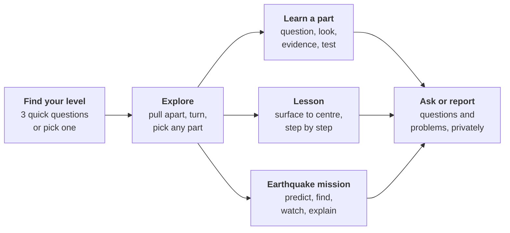
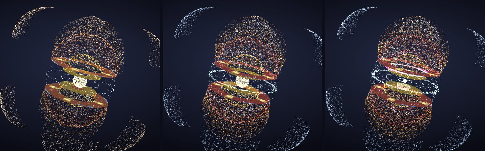
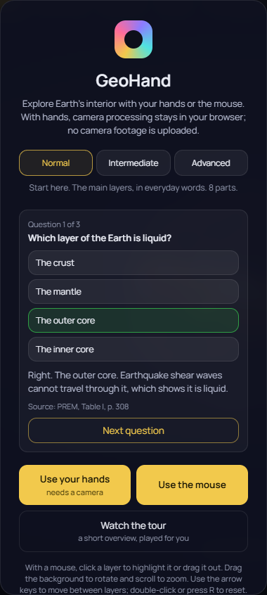
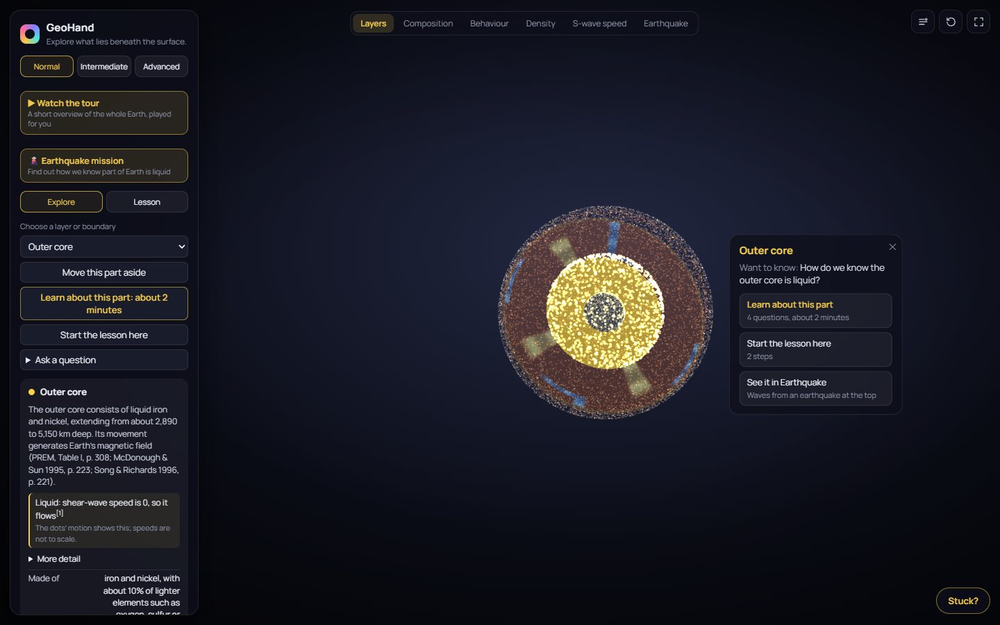
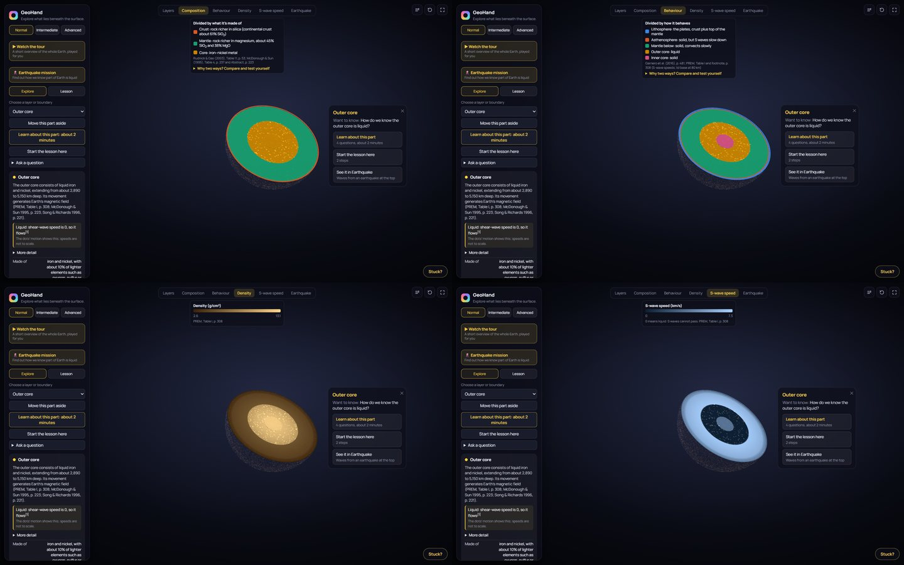
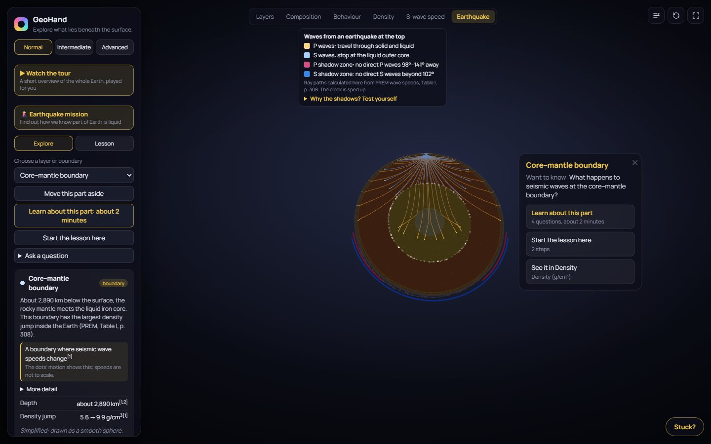
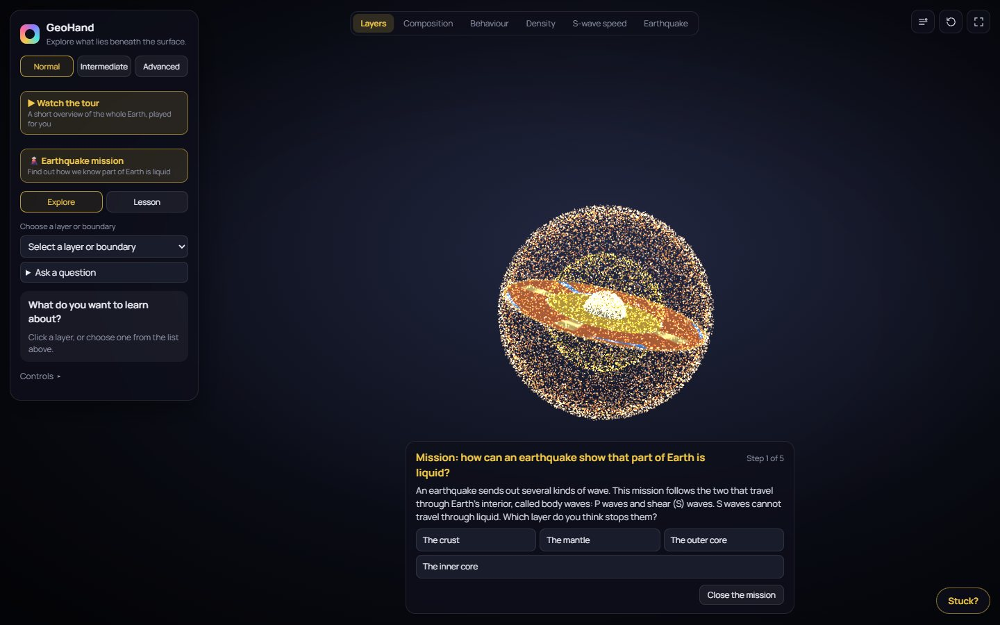
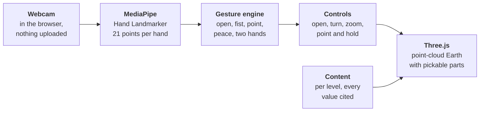

<div align="center">

# GeoHand

Created and maintained by **[Ibaad Sidik](https://github.com/IbaadGEO)** · hand tracking built on **[HoloHand](https://github.com/tubakhxn/HoloHand-Gesture-Agent-3D)** by Tuba Khan

**Pull the Earth apart with your hands, pick any layer, and see the evidence for what is inside: at three levels, with every number cited to the page**

[](https://geohand-theta.vercel.app) [](#camera-privacy-and-security)  [](#references)    [](LICENSE)

<a href="https://geohand-theta.vercel.app"></a>

<sub>Pulling the Earth apart, turning it, picking the core–mantle boundary and switching to the Earthquake view. Recorded with the mouse in headless Chromium; with a webcam the same actions are done by hand. Try it at <a href="https://geohand-theta.vercel.app">geohand-theta.vercel.app</a> (desktop Chrome, Edge or Firefox).</sub>

</div>

## About

This is part of my wider learning in coding, data, machine learning and geoscience. It is not a professional or commissioned study.

Nobody has seen the inside of the Earth. Everything we know about the core and mantle comes from indirect evidence, mostly earthquake waves, and that evidence is hard to picture from a textbook diagram. GeoHand lets you take the planet apart yourself: open it with two hands, point at a layer, and the app tells you what it is, how deep it is, how we know, and which page of which paper says so.

It began as the Earth's Interior model I added to my [HoloHand fork](https://github.com/IbaadGEO/HoloHand-Gesture-Agent-3D), which grew from Tuba Khan's gesture project. GeoHand turns that one model into a full learning tool, with three levels, guided lessons, a mission and a checked source behind every claim.

**Coming next:** more models will be added, chosen from what learner testing and feedback show people want to explore.

## What you can do



### Three levels, and a quick way to choose



| Level | What it covers | Parts | Questions |
|---|---|---|---|
| **Normal** | Start here. The main layers, in everyday words. | 8 | 53 |
| **Intermediate** | More layers, with the numbers and where they come from. | 16 | 98 |
| **Advanced** | What scientists still argue about, with exact sources. | 21 | 125 |



**Not sure which level?** The welcome screen asks three questions, each harder than the last: which layer is liquid, how deep the core starts, and whether the inner core turns with the rest of the planet. After each answer it shows the right one and its source. Your answers then pick a level for you (0–1 right: Normal, 2: Intermediate, 3: Advanced), and you can still choose any other. Nothing is saved or sent.

<br clear="right"/>

### Explore the planet



- **Pull it apart** to see every layer at once. Each one is named as it comes away.
- **Pick any layer or boundary** to read what it is, how deep it is and how we know, with in-text citations and page numbers.
- **The part card** beside the model offers three next steps: learn about this part, start the lesson from here, or see it in the view that shows it best.
- **Glossary terms** such as PREM, S waves and pyrolite are explained in plain words at Normal level.

### See it in different ways



Composition, behaviour, density and S-wave speed (above) colour an equatorial cut from published models. The **Earthquake** view traces P and S waves through PREM and calculates the shadow zones from them; the waves you see are worked out in the browser, not drawn by hand. Intermediate and Advanced add **crust thickness** (CRUST1.0), **temperature** (Katsura, 2022), **lithosphere depth** from seafloor age (Seton et al., 2020; Fischer et al., 2010) and, at Advanced, a **tomography** slice through the SEMUCB-WM1 model (French and Romanowicz, 2014; EarthScope EMC, doi:10.17611/dp/emc.2023.semucbwm1.1), shown with the authors' permission.



### Learn by doing



- **Learn about a part:** a two-minute drill-in for every layer and boundary. It asks a question, shows where the part is, explains how it works, gives you a task on the model, shows the evidence and ends with a short test.
- **Lessons:** walk from the surface to the centre one stop at a time, with activities such as comparing ocean and continental crust.
- **Earthquake mission:** predict which layer stops S waves, open the Earth, find the core–mantle boundary, watch the waves and explain what they show.
- **The tour:** a short overview that plays itself, with no hands or mouse needed.
- **Stuck?** goes back a step, repeats it, jumps to any step, or lets you ask a question or report a problem.

## How to use it

1. Open [geohand-theta.vercel.app](https://geohand-theta.vercel.app) on a desktop or laptop.
2. Choose a level, or answer the three questions to have one suggested.
3. Press **Use your hands** (the browser asks for the camera) or **Use the mouse**.
4. A short intro shows you how to turn the Earth, pull it apart and pick a part. You can skip it.

| Action | Mouse and keyboard | Hands |
|---|---|---|
| Turn the Earth | Drag the background | Open your hand and move it |
| Open it | **Pull it apart**, or the space bar | Both hands open, pulled apart; or point at the Earth and hold |
| Close it | Double-click, or press R | Point at **Put Earth back together** |
| Pick a part or press a button | Click it | Point at it and hold until the ring fills |
| Zoom | Scroll | Two fists, moved apart or together |
| Next layer | Arrow keys | Peace sign, held still |

## How it works



Every frame, MediaPipe finds up to two hands and returns 21 landmarks for each. The gesture engine turns them into a pose and a fingertip position, and holds each pose for a moment before acting, so a hand passing through a shape does not trigger anything. The Earth is drawn as layered point clouds, with depths taken from PREM (Dziewonski and Anderson, 1981) and ak135 (Kennett, Engdahl and Buland, 1995). Every sentence the app shows comes from content files that a checker tests against the reference list before each release.

## How it was built and tested

GeoHand was built over 44 commits in two days of focused work, then tested by hand with a real webcam, by external reviewers, and live after deployment. Every change kept the automated tests passing.

| What was checked | How |
|---|---|
| **202 automated checks** | 183 unit tests across 22 files (content, models, wave paths, levels, search, lessons, pointing, the question and report endpoint) plus 19 gesture self-tests replayed from recorded hand data |
| **Content against the sources** | A content check fails on any claim without a known reference, any draft text, and, for a release, any reference not yet checked against the paper itself. Every value and its page is logged in [`docs/values-to-check.md`](docs/values-to-check.md) |
| **13 real-camera test runs** | A guided test (developer builds only) asks for each gesture in turn, records both hands, the fingertip and what it pointed at, and scores whether the right thing happened. Each run's recording was analysed and the fixes checked in the next run |
| **External reviews** | An independent check of the numbers and wording against 16 of the source PDFs, and reviews of the app as a first-time learner with mouse and camera |
| **The live site** | Every refusal path of the question endpoint (wrong site, bad data, oversized, bot trap, rate limit) and a real question and bug report sent, stored and deleted |

### Bugs found and fixed

| What went wrong | Why | Fix |
|---|---|---|
| Swipe, point and pinch commands fired when nobody meant them | Live recordings showed hands passing through those shapes during ordinary movement | Commands rebuilt around poses held still, with a filling ring; swipes removed |
| The two hands swapped roles mid-gesture | MediaPipe's Left/Right label flips between frames | Hands followed by position instead |
| Lowering both hands closed the Earth, in every test run | Hands come together as they drop | Hands now only open it; a button closes it |
| Raising hands that were already apart opened the Earth on arrival | Opening read the gap between the hands, not how far they pulled | Opening measured from the closest the hands have been |
| The Earth reopened by itself after a reset | The pull remembered an old starting gap | The pull starts again whenever the Earth is closed another way |
| Pointing to open the Earth also picked a layer straight away | The hold carried on into the newly opened model | No pick until the fingertip moves off that spot |
| The reset button was out of reach | At the bottom of the screen, a pointing hand leaves the camera view | Moved to the top right |
| Clicking the view bar selected the layer behind it | Clicks passed through the bar to the model | Interface clicks no longer reach the model |
| A review found questions would be refused once live | The site's no-referrer policy makes the browser send `Origin: null` | The form asks for its real origin |
| A font failed to load on the live site | The security policy blocked fonts built into the page | Policy allows built-in fonts only |
| "Outer core is the only liquid layer in PREM" | PREM also has a liquid ocean layer | Corrected, with the other findings of the external review |

## Camera, privacy and security

| Guarantee | How it is enforced |
|---|---|
| **Camera images never leave your device** | Frames go from the camera to MediaPipe running in the page. No code records, saves or sends them. The Content-Security-Policy (`connect-src 'self'`) makes the browser refuse connections to any other server |
| **No trackers or third-party code** | The app, the MediaPipe engine, the hand model and the font are served from this site. `default-src 'self'` blocks loading anything from elsewhere |
| **Camera only** | The Permissions-Policy blocks the microphone, location, screen capture and other devices |
| **Questions and reports send only what they say** | A question sends its text, the level and the selected part. A report adds mouse or hands, the view, what was running, the browser name and version, and the screen size. No camera images or screenshots |
| **No IP addresses stored** | The IP is used only as a daily-changing hash to allow 5 messages an hour and 20 a day |
| **Bots and other sites are refused** | Messages are accepted only from this site, checked field by field, capped in size, and a hidden bot trap stores nothing |

To check it yourself, open the browser's developer tools (F12), go to the Network tab and reload: every request goes to the site itself.

## Questions and bug reports

**Ask a question** (in the panel) and **Report a problem** (in the Stuck? menu) go to a private inbox. Answered questions are added to the app with a source, and appear under [Live updates](#live-updates).

## Run it locally

```
npm install
npm run dev
npm test
```

`npm run dev` opens the app; adding `?debug` to its address starts the guided gesture test, which the public site leaves out. `npm run updates` regenerates the references and live updates in this README from the app's content.

## Credits

Hand tracking and the first version of the gesture code come from [HoloHand](https://github.com/IbaadGEO/HoloHand-Gesture-Agent-3D), my fork of Tuba Khan's [HoloHand-Gesture-Agent-3D](https://github.com/tubakhxn/HoloHand-Gesture-Agent-3D); that code stays under its MIT licence, in [`LICENSE-HoloHand`](LICENSE-HoloHand). GeoHand uses [MediaPipe](https://ai.google.dev/edge/mediapipe/solutions/vision/hand_landmarker) for hand tracking, [three.js](https://threejs.org) for the 3D view and the [Manrope](https://github.com/sharanda/manrope) font (SIL Open Font License 1.1). Reference animations that inspired some views are credited in [`docs/inspiration.md`](docs/inspiration.md).

## Licence

Copyright © 2026 Ibaad Sidik. **All rights reserved.** GeoHand's code, content, questions, design and media may not be copied, reused or built on without written permission; see [`LICENSE`](LICENSE). You are welcome to use the live site for your own learning.

## References

Every source the app cites, generated from its reference list (`npm run updates`). In the app, each claim also gives the page or table it comes from.

<!-- references:start -->
- Anzellini, S., Dewaele, A., Mezouar, M., Loubeyre, P. and Morard, G. (2013) 'Melting of iron at Earth's inner core boundary based on fast X-ray diffraction', *Science*, 340(6131), pp. 464–466. Available at: https://doi.org/10.1126/science.1233514
- Christensen, N.I. and Mooney, W.D. (1995) 'Seismic velocity structure and composition of the continental crust: A global view', *Journal of Geophysical Research: Solid Earth*, 100(B6), pp. 9761–9788. Available at: https://doi.org/10.1029/95jb00259
- Davies, J.H. and Davies, D.R. (2010) 'Earth's surface heat flux', *Solid Earth*, 1(1), pp. 5–24. Available at: https://doi.org/10.5194/se-1-5-2010
- Deuss, A. (2014) 'Heterogeneity and anisotropy of Earth's inner core', *Annual Review of Earth and Planetary Sciences*, 42, pp. 103–126. Available at: https://doi.org/10.1146/annurev-earth-060313-054658
- Dziewonski, A.M. and Anderson, D.L. (1981) 'Preliminary reference Earth model', *Physics of the Earth and Planetary Interiors*, 25(4), pp. 297–356. Available at: https://doi.org/10.1016/0031-9201(81)90046-7
- Fischer, K.M., Ford, H.A., Abt, D.L. and Rychert, C.A. (2010) 'The lithosphere–asthenosphere boundary', *Annual Review of Earth and Planetary Sciences*, 38, pp. 551–575. Available at: https://doi.org/10.1146/annurev-earth-040809-152438
- French, S.W. and Romanowicz, B. (2015) 'Broad plumes rooted at the base of the Earth's mantle beneath major hotspots', *Nature*, 525(7567), pp. 95–99. Available at: https://doi.org/10.1038/nature14876
- French, S.W. and Romanowicz, B.A. (2014) 'Whole-mantle radially anisotropic shear velocity structure from spectral-element waveform tomography', *Geophysical Journal International*, 199(3), pp. 1303–1327. Available at: https://doi.org/10.1093/gji/ggu334
- Frost, D.J. (2008) 'The upper mantle and transition zone', *Elements*, 4(3), pp. 171–176. Available at: https://doi.org/10.2113/gselements.4.3.171
- Fukao, Y. and Obayashi, M. (2013) 'Subducted slabs stagnant above, penetrating through, and trapped below the 660 km discontinuity', *Journal of Geophysical Research: Solid Earth*, 118(11), pp. 5920–5938. Available at: https://doi.org/10.1002/2013jb010466
- Garnero, E.J., McNamara, A.K. and Shim, S.-H. (2016) 'Continent-sized anomalous zones with low seismic velocity at the base of Earth's mantle', *Nature Geoscience*, 9(7), pp. 481–489. Available at: https://doi.org/10.1038/ngeo2733
- Hirose, K., Labrosse, S. and Hernlund, J. (2013) 'Composition and state of the core', *Annual Review of Earth and Planetary Sciences*, 41, pp. 657–691. Available at: https://doi.org/10.1146/annurev-earth-050212-124007
- Ishii, M. and Dziewoński, A.M. (2002) 'The innermost inner core of the earth: Evidence for a change in anisotropic behavior at the radius of about 300 km', *Proceedings of the National Academy of Sciences*, 99(22), pp. 14026–14030. Available at: https://doi.org/10.1073/pnas.172508499
- Katsura, T. (2022) 'A revised adiabatic temperature profile for the mantle', *Journal of Geophysical Research: Solid Earth*, 127(2), e2021JB023562. Available at: https://doi.org/10.1029/2021JB023562
- Kennett, B.L.N., Engdahl, E.R. and Buland, R. (1995) 'Constraints on seismic velocities in the Earth from traveltimes', *Geophysical Journal International*, 122(1), pp. 108–124. Available at: https://doi.org/10.1111/j.1365-246x.1995.tb03540.x
- Laske, G., Masters, G., Ma, Z. and Pasyanos, M. (2013) 'Update on CRUST1.0: A 1-degree global model of Earth’s crust', *Geophysical Research Abstracts*, 15, EGU2013-2658. Available at: https://igppweb.ucsd.edu/~gabi/crust1.html
- Lay, T., Williams, Q. and Garnero, E.J. (1998) 'The core–mantle boundary layer and deep Earth dynamics', *Nature*, 392(6675), pp. 461–468. Available at: https://doi.org/10.1038/33083
- McDonough, W.F. and Sun, S.-s. (1995) 'The composition of the Earth', *Chemical Geology*, 120(3–4), pp. 223–253. Available at: https://doi.org/10.1016/0009-2541(94)00140-4
- Mooney, W.D., Laske, G. and Masters, T.G. (1998) 'CRUST 5.1: A global crustal model at 5° × 5°', *Journal of Geophysical Research: Solid Earth*, 103(B1), pp. 727–747. Available at: https://doi.org/10.1029/97jb02122
- Murakami, M., Hirose, K., Kawamura, K., Sata, N. and Ohishi, Y. (2004) 'Post-perovskite phase transition in MgSiO₃', *Science*, 304(5672), pp. 855–858. Available at: https://doi.org/10.1126/science.1095932
- Pearson, D.G. et al. (2014) 'Hydrous mantle transition zone indicated by ringwoodite included within diamond', *Nature*, 507(7491), pp. 221–224. Available at: https://doi.org/10.1038/nature13080
- Rudnick, R.L. and Gao, S. (2003) 'Composition of the continental crust', *Treatise on Geochemistry*, 3, pp. 1–64. Available at: https://doi.org/10.1016/b0-08-043751-6/03016-4
- Seton, M., Müller, R.D., Zahirovic, S., Williams, S., Wright, N.M., Cannon, J., Whittaker, J.M., Matthews, K.J. and McGirr, R. (2020) 'A global data set of present-day oceanic crustal age and seafloor spreading parameters', *Geochemistry, Geophysics, Geosystems*, 21(10), e2020GC009214. Available at: https://doi.org/10.1029/2020GC009214
- Song, X. and Richards, P.G. (1996) 'Seismological evidence for differential rotation of the Earth's inner core', *Nature*, 382(6588), pp. 221–224. Available at: https://doi.org/10.1038/382221a0
- White, R.S., McKenzie, D. and O'Nions, R.K. (1992) 'Oceanic crustal thickness from seismic measurements and rare earth element inversions', *Journal of Geophysical Research: Solid Earth*, 97(B13), pp. 19683–19715. Available at: https://doi.org/10.1029/92jb01749
- Yang, Y. and Song, X. (2023) 'Multidecadal variation of the Earth's inner-core rotation', *Nature Geoscience*, 16(2), pp. 182–187. Available at: https://doi.org/10.1038/s41561-022-01112-z
<!-- references:end -->

**Data**

- French, S.W. and Romanowicz, B.A. (2014) *SEMUCB-WM1* [Earth model], EarthScope Earth Model Collaboration. Available at: https://doi.org/10.17611/dp/emc.2023.semucbwm1.1 (Accessed: 23 November 2026). Used and displayed with the authors' permission.

**Software**

- Google (2026) *MediaPipe Hand Landmarker*. Available at: https://ai.google.dev/edge/mediapipe/solutions/vision/hand_landmarker (Accessed: 23 November 2026).
- Khan, T. (2026) *HoloHand-Gesture-Agent-3D*. Available at: https://github.com/tubakhxn/HoloHand-Gesture-Agent-3D (Accessed: 23 November 2026).
- three.js authors (2024) *three.js*, release 170. Available at: https://threejs.org (Accessed: 23 November 2026).
- The Manrope Project Authors (no date) *Manrope*. Available at: https://github.com/sharanda/manrope (Accessed: 23 November 2026).

## Live updates

Questions visitors asked that now have a cited answer in the app, newest first.

<!-- live-updates:start -->
_No visitor questions answered yet._
<!-- live-updates:end -->
